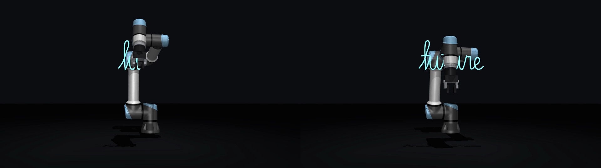

# UR7e writes "future" in the air

The lab UR7e writes a cursive **future** with its gripper fingertips, about 33 × 15 cm, in the
air in front of the arm with the word's centre 20 cm above the tuck fingertip position, in
**under a minute** (58 s at 30 % speed slider, 35 s at 50 %). Every command goes
through the course's `validate_trajectory` node. The gripper stays on and isn't commanded.



`media/future_preview.mp4` shows the same plan in sim, seen from where the word reads correctly.

## At the lab

First time:

```bash
git clone https://github.com/jusstinn/ur73-arm-.git ~/ur73-arm
```

After that:

```bash
cd ~/ur73-arm && git pull
```

Every terminal below starts with `distrobox enter ros2`, then `cd ~/ur73-arm`. The pendant's
External Control program must be running.

1. **Terminal A**, connect ROS to the arm and leave it running (Lab 3 §1.1):
   ```bash
   ./run.sh comms        # = ros2 run ur7e_utils enable_comms, lab3 workspace sourced
   ```
2. **Terminal B**, the course validator, left running:
   ```bash
   ./run.sh validator    # = ros2 run joint_control validate_trajectory
   ```
3. Set the pendant's **speed slider to 30 %** (58 s run; 50 % = 35 s; tested range 30-50 %).
   Check what the robot actually reports with `./run.sh speed` (data: 30.0). The first lab
   run stopped because the robot was at ~6 % while 30 was typed. The node now reads this value
   itself and follows it live.
   Clear about 45 cm wide and 10 cm deep around the gripper, from tuck height up to 35 cm
   above it, plus the arm's space between there and the base.
4. **Terminal C**:
   ```bash
   ./run.sh check        # no ROS: should print "all variants finish" twice
   ./run.sh tuck         # = ros2 run ur7e_utils tuck (moves the arm to tuck)
   ./run.sh dry          # ROS checks only, moves nothing: prints the robot's speed + "dry run OK"
   ./run.sh draw         # hand on the e-stop, Enter starts; ~58 s at 30 %, ends back at tuck
   ./run.sh trace        # the path it actually drew -> runs/<name>.drawn.svg / .drawn.json
   ```
5. To bring the data home:
   ```bash
   git add runs && git commit -m "UR7e draw run" && git push
   ```

The plan clock follows the robot's live speed scaling (`/speed_scaling_state_broadcaster/
speed_scaling`). Moving the slider mid-run just changes the pace, and pausing the program
pauses the drawing (stopped after 10 s paused). A number after `dry` or `draw` is only a
cross-check. Ctrl-C at any time sends a hold at the current position.

### Say hello (the website wave)

With terminals A (comms) and B (validator) running and the arm at tuck (`./run.sh tuck`):

```bash
./run.sh alias      # once per computer: afterwards the word `run` does the line below
run                 # = ./run.sh hello: 5 s countdown, then the arm raises its hand and waves
```

The arm lifts its tool ~0.4 m inside the validator's band (every joint within 0.40 rad of
tuck), flaps the hand up and down 4 times (~0.5 Hz at 100 %, slower at lower sliders) and
returns to tuck: ~10.5 s at 100 %, ~21 s at 50 %. Tested in the twin at 30 and 50 % slider
(every controller variant finishes); at 70-100 % slower-servo variants trip the tracking guard,
which stops and holds the arm, so keep the slider at 30-50 % until a real run says otherwise.
Ctrl-C during the countdown aborts before anything moves; Ctrl-C later holds where it is.
`./run.sh hello 10` gives a 10 s countdown. Logs go to `runs/hello_<time>.jsonl`.

### Where to stand or film

The word reads correctly from in front of the tool, looking back at the robot (the side the
arm reaches toward at tuck). To film from behind the arm instead:

```bash
./run.sh plan --mirror
```

Then `./run.sh check` and run as above. The planner refuses any plan that leaves the safe band.

## What it does

- **`ur7e_draw/plan.py`**: the letters (`letters.py`, one cursive stroke plus the f and t
  crossbars) go on a vertical plane, centred 0.20 m above the tuck fingertip position
  (`--offset right,up`). IK runs at 100 Hz on the fingertip position only (UR DH, null-space
  pull toward tuck), so the gripper tilts (up to 31°) and the joints share the motion. That's
  what lets the word sit higher. The ceiling is about +0.30 m before the 0.40 rad margin, and
  the validator's 0.5 rad comes at about +0.40 m. The fingertips write at 20 cm/s (at 100 %
  slider), come to rest at sharp corners, and arc 3 cm back toward the base between strokes.
  The plan starts and ends exactly at tuck: 17.4 s at 100 %. Checks: every joint within
  0.40 rad of tuck (max used: 0.24), joint speed ≤ 0.8 rad/s (max used: 0.43, against a UR7e
  limit of 3.14), fingertips ≥ 0.15 m above
  the table (gripper 0.14 m from lab5; table at z ≈ −0.20 m estimated from lab5's cube
  pose; `--gripper` to change), IK error < 0.01 mm. The result is `plans/future.json`.
- **`ur7e_draw/stream.py`**: the validator only takes one point, zero velocities, the
  validator's joint order, and every joint within 0.5 rad of tuck. So the plan streams at
  25 Hz as one single-point trajectory per tick, each lasting one tick and aiming one tick
  ahead (timing scaled by the speed slider). Guards: stale `/joint_states` (0.2 s) → stop;
  any joint more than 0.48 rad from tuck → stop and hold; arm more than 0.10 rad off the plan
  → stop and hold. Goals are clamped to tuck ± 0.45 rad and to 0.032 rad per tick from the
  measured position.
- **Controller twin** (`JTCTwin`, a kinematic model of the scaled JTC): tested with both
  restart behaviours × 4 servo lags × ±15 ms timing jitter. The first lab log fits the
  "restart from measured" behaviour with a tight servo. At 30 % and 50 % slider every
  case finishes and the letters stay within 6 mm of the plan. At 100 %, the two 60 ms
  servo-lag cases trip the tracking guard and stop safely. The guard also stops a run where
  `--speed-slider` is set higher than the pendant before the word smears.
- **`ur7e_draw/node.py`**: the ROS 2 shell. It reads `/joint_states` (any joint order) and
  publishes ONLY to `/joint_trajectory_validated`. Logs every tick to `runs/<name>.jsonl`.
- **`ur7e_draw/trace.py`**: turns the log into the measured flange path. You get an SVG in
  stroke order (for a stroke-dashoffset reveal) and a JSON with t, joints, xyz, word-plane
  u/v and the pen flag, for animating.
- **`ur7e_draw/preview.py`** (dev machine only): renders a plan or a drawn run in MuJoCo.

Needs only `python3` + `numpy` at the lab (ROS 2 Humble supplies rclpy and the messages).
Dev: `pytest` (20 tests, including the node end-to-end against fake ROS), plus `mujoco` and
`imageio[ffmpeg]` for previews.

## Status / caveats

- **Not yet run on the real arm.** Tested against the twin and fake ROS only.
- Get the TA's OK before streaming from a student node, and do the first run at 30 %.
- The validator is unchanged and stays in the loop. Nothing here publishes to the controller
  directly.
- Kinematics: UR's own `ur7e/default_kinematics.yaml` is identical to the UR5e's, and the DH
  model here matches MuJoCo Menagerie's UR5e to ~1 mm.

## Sim showcase (big word, for video)

`python3 -m ur7e_draw.showcase` (dev machine, MuJoCo) renders a larger 62 × 28 cm "future"
with a glowing trail, from the front and at 45°, in dark and light styles. It also writes
per-frame joints and tip positions for animation. It's posed far from tuck, so it's for video
only and never runs on the arm.
